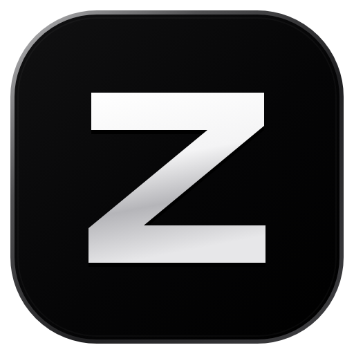

  

<h1 align="center">Zulia</h1>

  Your companion app for <strong>BNS NEO</strong>. 
  Damage meter, field boss timers, coupon codes and in-game overlays, all in one place.

  <a href="../../releases/latest"><strong>⬇ Download Zulia 1.0</strong></a>
  &nbsp;·&nbsp;
  <a href="https://discord.gg/28zWmHQcTD">Discord</a>
  &nbsp;·&nbsp;
  <a href="https://www.xsolbe.com">xsolbe</a>

---

## Zulia 1.0 is here 🎉

This is the first official release of Zulia.

## What's inside

- **DPS Meter:** live overlay, damage details for each player and the Leaderboard.
- **Field Boss Timer:** schedules, countdowns, alerts and an in-game overlay.
- **Coupon Codes:** copy the active codes and see the rewards of each one.
- **Memory Cleaner:** periodically reduces the memory used by BNS NEO.
- **Overlay Editor (Alt+E):** place and resize everything over the game.
- **English and Portuguese**, with automatic updates.

## Install

1. Open the [latest release](../../releases/latest).
2. Under **Assets**, download the `.exe` file (`Zulia-…-setup.exe`).
3. Run it and accept the administrator prompt.

Zulia requires Windows (64-bit) and updates itself after that.

> **Windows SmartScreen:** the installer is not code-signed yet, so Windows may warn about an unknown publisher. Choose **More info**, then **Run anyway**.

> **Looking for the app?** Download the `.exe`. The "Source code" files that GitHub adds to every release only contain this page.

## Help

Questions, problems or ideas? Join the [Discord](https://discord.gg/28zWmHQcTD).

---

<strong>🇧🇷 Português</strong>

### O Zulia 1.0 chegou

Esta é a primeira versão oficial do Zulia, o seu aplicativo para **BNS NEO**.

- **DPS Meter:** overlay ao vivo, detalhes de dano de cada jogador e Leaderboard.
- **Field Boss Timer:** horários, contagem regressiva, alertas e overlay no jogo.
- **Cupons:** copie os códigos ativos e veja as recompensas de cada um.
- **Memory Cleaner:** reduz periodicamente a memória usada pelo BNS NEO.
- **Overlay Editor (Alt+E):** posicione e redimensione tudo sobre o jogo.
- **Inglês e português**, com atualização automática.

### Como instalar

1. Abra a [versão mais recente](../../releases/latest).
2. Em **Assets**, baixe o arquivo `.exe` (`Zulia-…-setup.exe`).
3. Execute e aceite o pedido de administrador.

O Zulia precisa do Windows (64 bits) e depois se atualiza sozinho.

> **Aviso do Windows:** o instalador ainda não tem assinatura digital, então o Windows pode avisar sobre um editor desconhecido. Escolha **Mais informações** e depois **Executar assim mesmo**.

> Os arquivos "Source code" que o GitHub adiciona a cada versão contêm apenas esta página. O aplicativo é o `.exe`.

Dúvidas, problemas ou ideias? Entre no [Discord](https://discord.gg/28zWmHQcTD).

